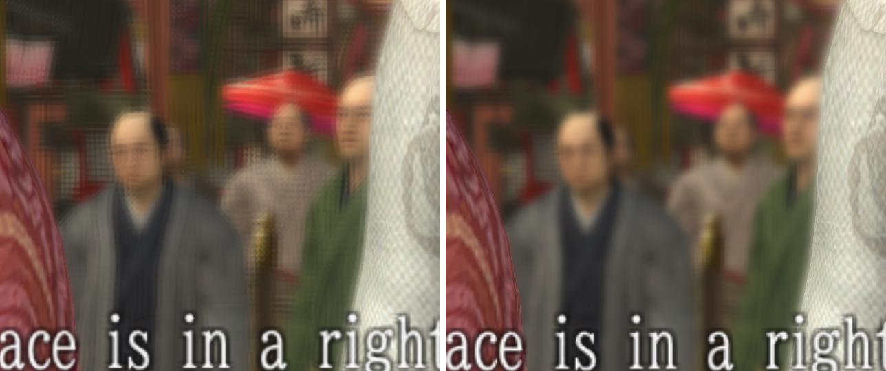

# Yakuza Kenzan! at 60 and 120 FPS

**Play *Ryu ga Gotoku Kenzan!* on RPCS3 at 60 or 120 FPS, at the game's original speed, with a much cleaner picture.**

**[Drag the slider to see it for yourself](https://cptpakundo.github.io/YakuzaKenzanFPSPatch/compare/)**. Left: the original picture. Right: 2.0 with the Clean picture entry.

**[Download 2.0](https://github.com/CptPakundo/YakuzaKenzanFPSPatch/releases/latest)** · [Install in 5 steps](#installation) · [Clean picture](#clean-picture)

## What you get

- **The whole game at 60 or 120 FPS.** Fights, heat actions, cutscenes, the open world and all 14 minigames.
- **Everything at its original speed.** Running Kenzan above 30 FPS normally speeds the game up. This patch corrects that, so only the smoothness changes.
- **Steady speed when the frame rate drops.** If your PC falls behind, the game draws fewer frames and keeps its pace.
- **A cleaner picture at any Resolution Scale.** The Clean picture entry stops the game blurring its own finished frame and removes the grid pattern from blurred backgrounds. No files to copy.
- **Works with the [English fan translation](https://www.moddb.com/mods/ry-ga-gotoku-kenzan-english-translation-patch)** and the **Japanese original**.

## Installation

1. Download [`imported_patch.yml`](https://github.com/CptPakundo/YakuzaKenzanFPSPatch/releases/latest/download/imported_patch.yml)
   from the [latest release](https://github.com/CptPakundo/YakuzaKenzanFPSPatch/releases/latest).
2. Place it in RPCS3's `patches` folder, keeping the name `imported_patch.yml`:

   | OS | Folder |
   |---|---|
   | Windows | `<RPCS3 folder>\patches\` |
   | Linux | `~/.config/rpcs3/patches/` |
   | macOS | `~/Library/Application Support/rpcs3/patches/` |

   Already have an `imported_patch.yml`? Merge the two files instead of replacing yours (see below).
3. In RPCS3, open **Manage → Game Patches** and find *Ryu ga Gotoku Kenzan!*. The list is long because it covers every version of the game, but you only need the entries for yours:

   | Your game | Frame rate: tick **one** | Picture | Minigames: tick **all** of these |
   |---|---|---|---|
   | **English translation** | `60 FPS (English translation)` **or** `120 FPS (English translation)` | `Clean picture (English translation)` | Every `Minigame fixes` entry ending in `(English translation)`, and the four with no label: `Bowling`, `K Yabusame`, `Konpira`, `Shogi` |
   | **Japanese original** | `60 FPS (Japanese original)` **or** `120 FPS (Japanese original)` | `Clean picture (Japanese original)` | Every `Minigame fixes` entry ending in `(Japanese original)`, and the four with no label: `Bowling`, `K Yabusame`, `Konpira`, `Shogi` |

   English frame-rate and picture entries appear twice, each with a hash added to the name. Tick the ones for your version:
   - **Patches 6, 7, 8 and 9:** the hash starting `PPU-0f7ee1f5`
   - **Initial release:** the hash starting `PPU-5d3cde09`

   Entries for other versions do nothing, so don't worry about them.
4. Click **Save**. **Chose 60 FPS?** You're done. **Chose 120 FPS?** Do the short [120 FPS setup](#120-fps-setup) first.
5. Start the game. The first boot takes longer while RPCS3 recompiles the patched code.

<b>Merging with an existing <code>imported_patch.yml</code></b>

1. Keep a single `Version: 1.2` line at the very top of your file.
2. Copy everything below that line from this patch to the end of your file.
3. A file can only have one `Anchors:` section. If yours already has one, move this patch's indented anchor lines under
   your existing `Anchors:` line and delete the second `Anchors:` line.

### Upgrading from 1.7

> [!NOTE]
> **Used the optional `sh_iori_ps3.par` before?** You no longer need it: tick the new `Clean picture` entry instead. Your copied file keeps working, or restore your backup of the original.

Replace `imported_patch.yml` and open Game Patches. Your ticks stay. Add the new entries for your version: `Clean picture`, and
`Minigame fixes - Hanafuda`, `Minigame fixes - Karuta` and `Minigame fixes - Tintiro`. Without them those three stay at 60 FPS,
at the right speed.

## 60 FPS setup

Nothing to change. Keep RPCS3's defaults (**Vblank Rate 60**, **Framerate Limiter Auto**).

Since 2.0 the game keeps its speed by drawing fewer frames when your PC falls behind, down to about 30 FPS, as long as your PC keeps
up with the game logic itself. If it cannot, the game slows down. Very crowded places, such as the Gion festival at night, are the
hardest, and there the limit is the emulated graphics work, so a lower Resolution Scale may not help. If a place is still too slow,
untick the `60 FPS` entry to play at the original 30 FPS.

## 120 FPS setup

Right-click the game → **Create Custom Configuration**, then set:

| Setting | Value |
|---|---|
| Advanced → Vblank Rate | **120** (required, otherwise the game runs at half speed) |
| GPU → Framerate Limiter | **Auto** (Off lets the game run far too fast) |
| VSync | On only with a 120 Hz+ display, otherwise Off |

> [!IMPORTANT]
> Kenzan runs its logic once per frame, so in earlier versions a frame drop slowed the whole game down. Since 2.0 the game keeps
> its speed by drawing fewer frames when your PC falls behind, down to about 30 FPS. That helps as long as your PC keeps up with
> the game logic itself. If it cannot, the game slows down, and in cutscenes the picture falls behind the sound.
>
> **On a weaker PC, use the 60 FPS entry.** It asks much less of your CPU. Very crowded places, such as the Gion festival at
> night, are the hardest, and there the limit is the emulated graphics work, so a lower resolution scale may not help.

Menus, dialogue and the start of heat actions run at 60 FPS, exactly as in the original game. The sections of six cutscenes that
the original drops to 20 FPS run at the full frame rate of your entry. To switch back, set Vblank Rate to 60 and enable the 60 FPS
entry instead.

## Supported versions

| Game version | Executable hash | Entries to enable |
|---|---|---|
| [English fan translation](https://www.moddb.com/mods/ry-ga-gotoku-kenzan-english-translation-patch) patches 6, 7, 8 and 9, same EBOOT (RPCS3 EBOOT) | `PPU-0f7ee1f50561dd854f48d4a74fbcb7b30f0307d6` | `... (English translation)` |
| English fan translation, initial release (RPCS3 EBOOT) | `PPU-5d3cde094c0be606290c4716da497bced59c1256` | `... (English translation)` |
| Japanese original | `PPU-fc24101547eff0f4307d4f70a0cb76329f11a525` | `... (Japanese original)` |

> [!NOTE]
> **English translation users:** make sure you followed the translation's *Extra Steps (RPCS3 Only)*: rename `EBOOT.BIN`
> to `EBOOT PS3.BIN`, then rename `EBOOT RPCS3.BIN` to `EBOOT.BIN`.

Other English mods and other builds of the translation have a different hash, so the frame-rate entries will not apply to them.
The translation's older PS3 EBOOT, `PPU-16d1a050...`, is not supported either: use its RPCS3 EBOOT.

Not sure which one you have? Boot the game once, close RPCS3, and search `log\RPCS3.log` for `PPU executable hash`. Use the
file rather than RPCS3's log window, which can hide that line.

<b>Frame rate still 30?</b>

The game's hash has to match one of the rows above. Game Patches lists every entry whether it matches or not, so ticking one
proves nothing. Check that:

1. `RPCS3.log` shows `PAT: Applied patch` with `60 FPS (...)` or `120 FPS (...)`. Only that line counts. Minigame lines appear
   only after a recompile or when you enter that minigame, so they say nothing about the frame rate.
2. The `PPU executable hash` line matches a row above, and you ticked that row's entries.
3. If the hash is not in the table, you have a different build. Please open an issue with that hash and where your English
   patch came from.

You can also find your version without a log. Boot the game once, open `cache/BLJM60064` in your RPCS3 folder and look for the
folder ending in `-EBOOT.BIN`. If there are several, use the newest:

| Folder | Version |
|---|---|
| `ppu-34oXhV146TgHnVhRobSfKm2zKfvG-EBOOT.BIN` | English patches 6, 7, 8 and 9, RPCS3 EBOOT |
| `ppu-tAZGq5tMbVY9f6aXrmbYWmZfegXC-EBOOT.BIN` | Japanese original |

Any other folder means a build these entries do not cover, unless you are on the translation's initial release, which has its own folder. Please open an issue with its name.

Clearing RPCS3's caches does not help with this.

<b>A minigame crashes as it starts?</b>

If you used a patch older than 1.6, RPCS3 may still hold a damaged compiled copy of a minigame. Close RPCS3 and delete the folders
named `ppu-...-mng_...` under `cache/BLJM60064`. RPCS3 rebuilds them the next time you enter that minigame.

## Clean picture

**[See the difference with the slider](https://cptpakundo.github.io/YakuzaKenzanFPSPatch/compare/)**

Kenzan's picture was made for 720p. At a high Resolution Scale, the game blurs every finished frame, its Depth of Field leaves a fine grid over blurred backgrounds and crowds, and an edge filter softens every edge. The `Clean picture` entry fixes all three, at any Resolution Scale, with no effect removed and no sharpening added. It works with or without the frame-rate entries.

No files to copy: the patch corrects the game's shaders as they load. If you copied `sh_iori_ps3.par` from an earlier release, it keeps working, and you can also restore the original.

## What gets corrected

Full list

- **Combat:** movement, strafing, turning, enemy AI (think rate, cooldowns, counter windows), heat gain and drain,
  knockdown and stun durations, grabs, mash prompts, sword slashes and afterimages, hit effects
- **Heat actions:** timeline speed, button and mash prompts, slow motion, weapon and limb trails, finishing effects
- **Attack trails:** length, fade and reuse of the weapon and limb trails on normal attacks
- **Cutscenes and events:** playback speed, slow-motion moments, chapter title cards, talk scenes (each plays once),
  talk cameras, skip timing, movie skip fade-out, subtitles, the 20 FPS sections
- **Field:** NPC behaviour and crowds, talk arrows above NPCs, dropped items, grass, trees, wind, sea water, splashes,
  rain splashes (on the ground and on characters in cutscenes), lights, particles, cloth, sound fades, doors and other
  animated scene parts
- **HUD and menus:** health and heat bars, text speed, result screens, map, pause-menu quit fade, restaurant meal and
  shop fades
- **Minigames:** Bowling, Chohan, Hanafuda, K Yabusame (Jiraiya training), Kamerace, Karuta, Konpira, Mahjong, R Yabusame, Shogi,
  Suika, Tintiro (Chinchirorin), Tousenkyo (including the fan's flight), Waterfall, plus scarecrow training and the minigames built
  into the main program.

## Good to know

- **Weaker PC?** Use the 60 FPS entry. It asks much less of your CPU.
- **VRR displays:** frame times still vary a little, and some OLED panels show this as flicker in crowded places.
- **Bowling:** the ball rolls at the full frame rate, and pins fall much as in the original.

Found something that runs too fast or too slow? Please [open an issue](https://github.com/CptPakundo/YakuzaKenzanFPSPatch/issues) with your game version, 60 or 120 FPS, what happened and where, and your `RPCS3.log` if the game crashed.

## Credits

- **Whatcookie**, for the earlier Kenzan 60 FPS canary patch that found the engine's native frame-rate switch
- **FlexBy**, whose *Yakuza: Dead Souls* 60 FPS patch (same engine family) served as a reference
- **The [*Like a Dragon: Kenzan!* English Patch](https://www.moddb.com/mods/ry-ga-gotoku-kenzan-english-translation-patch) team** (majDima, Arcodeaus, jurxd, PauseForTheCat, TheEdgyNerd and helpers)
- **The [RPCS3](https://rpcs3.net) team**, for the emulator and its patch system, and
  **[AniLeo](https://github.com/AniLeo)** in particular, whose tidy-up of this patch on the game's RPCS3 wiki page was a
  gentle reminder that a real PS3 was never going to hit 120 FPS anyway
- **[Ghidra](https://github.com/NationalSecurityAgency/ghidra)** and **[GhidraMCP](https://github.com/bethington/ghidra-mcp)**,
  used for the analysis

Developed with AI assistance (Claude by Anthropic).

## License

[MIT](LICENSE). *Ryu ga Gotoku Kenzan!* is © SEGA. This project is not affiliated with SEGA or the RPCS3 team. The patch
contains no game files. You need your own copy of the game.

<!-- readme-reviewed: 2.0 -->
